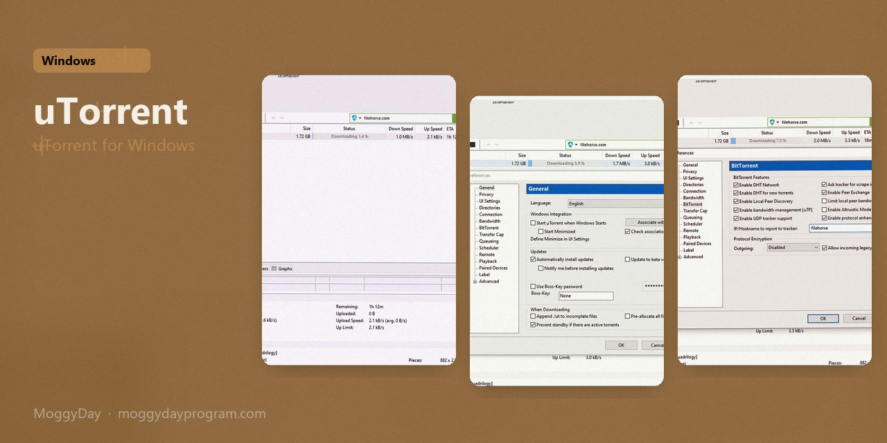
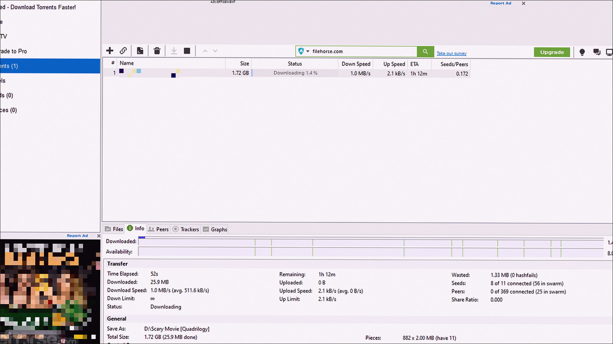
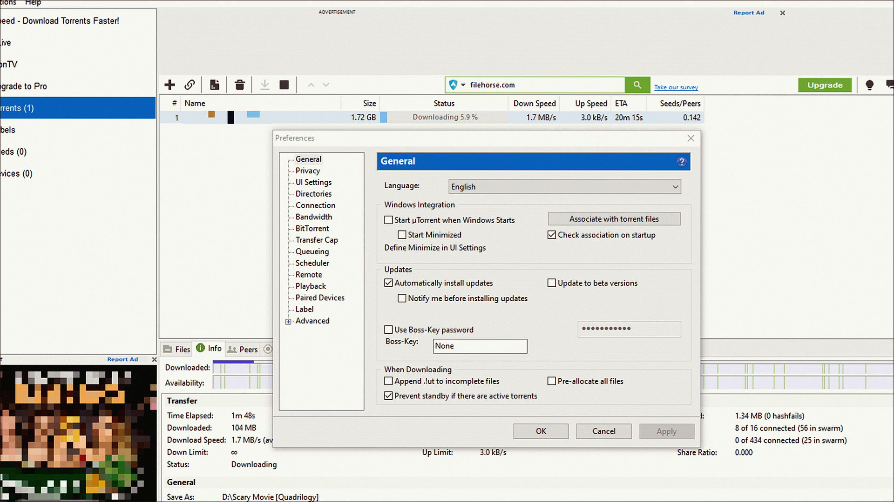
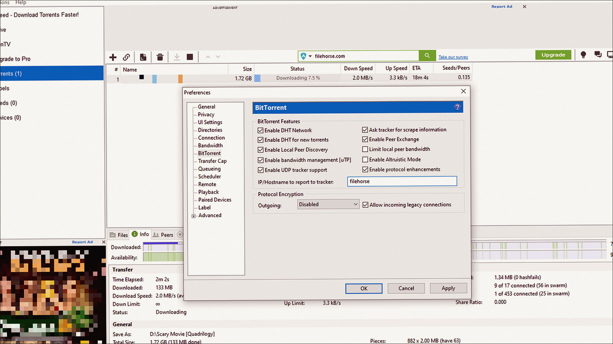

# uTorrent Pro 3.6

uTorrent for Windows. uTorrent Pro on Windows 10/11 x64. 36 MB. Requirements, screenshots, MoggyDay Launcher.

[Pages](https://cavernwithinshow.github.io/utorrent-windows/) · [RU](https://moggydayprogram.com/programs/utorrent) · [EN](https://moggydayprogram.com/en/programs/utorrent)

  

  
  
  

1. Open the RU or EN card on moggydayprogram.com
2. Use the main button, or the launcher for large archives

Category: [Utilities catalog](https://moggydayprogram.com/categories/utilities)

- [qBittorrent](https://moggydayprogram.com/programs/qbittorrent)
- [Internet Download Manager](https://moggydayprogram.com/programs/internet-download-manager)

No installer in this git repo.
